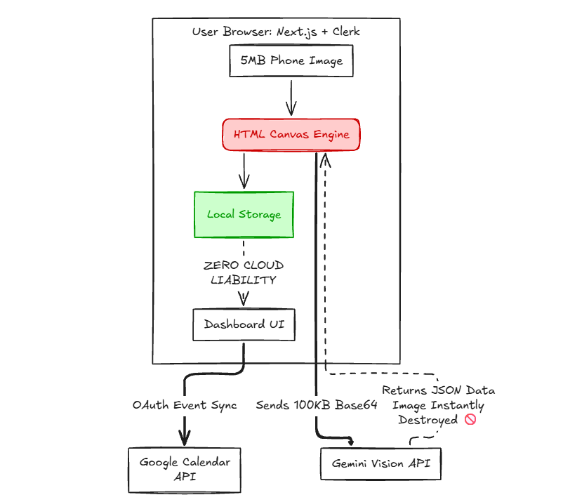

# Document Expiry Tracker

A privacy-first, AI-powered document expiration tracker built with **Next.js 14**, **Google Gemini Vision**, **Clerk**, and the **Google Calendar API**. Designed around a **zero-retention architecture**, it extracts expiration dates from sensitive documents and schedules automated renewal alerts without ever storing user files or PII in a cloud database.

**[Live Demo](https://document-expiry-tracker-iota.vercel.app)**

---

## The Problem

Individuals and families frequently miss critical renewal deadlines for documents like Driving Licenses, Vehicle PUCs, and Passports—leading to fines or disrupted travel. Meanwhile, existing tracking apps force users to upload sensitive ID images to centralized cloud databases, creating unnecessary privacy risks and data-breach liability.

## The Solution

**Document Expiry Tracker** processes sensitive documents on the edge and keeps user data strictly on the client device:
1. **Client-Side Image Compression:** Compresses high-resolution mobile photos (~5MB) down to ~100KB Base64 strings directly in the browser via HTML5 Canvas.
2. **Instant AI Extraction:** Sends the compressed payload to Google Gemini Vision to parse the document type and expiry date, then immediately purges the image from memory (`0 bytes` retained).
3. **User-Scoped Local Storage:** Uses Clerk authentication to isolate sessions per user (`expiryDocs_${user.id}`) in tamper-validated browser `localStorage`—eliminating cloud database liability and hosting costs.
4. **One-Click Calendar Alerts:** Integrates Google Calendar via OAuth 2.0 to schedule 30-day pre-expiry reminders directly onto the user's personal calendar.

---

## Key Features

* **Drag-and-Drop AI OCR Upload:** Drag and drop any document image (or upload via file picker) to automatically detect document type and expiration date.
* **Executive Analytics Dashboard:** Real-time summary cards tracking **Total Tracked**, **Action Required** ($\le 30$ days or expired), and **Safe** ($> 30$ days) documents.
* **Smart Filtering & Sorting:** Filter records by urgency status or family member, and sort chronologically by earliest expiration date or recently added.
* **Manual Entry Fallback:** Add non-physical renewals or subscriptions manually without invoking the AI pipeline.
* **Tamper-Proof State Validation:** Defensive `localStorage` parsing with schema validation filters out corrupted records on load to prevent runtime UI crashes.
* **Google Calendar Sync:** Pushes automated renewal events directly to the user's Google Calendar via OAuth 2.0.

---

## Architecture & Data Flow

### Engineering Challenge: Serverless Payload Limits
* **What Broke:** Uploading raw 4MB–5MB smartphone photos directly to Next.js API routes triggered serverless payload limits and inflated Gemini token latency.
* **How It Was Fixed:** Built a client-side HTML5 `<canvas>` downscaling pipeline that resizes and compresses images to ~100KB Base64 strings *before* making the network request, ensuring fast extraction within free-tier limits.